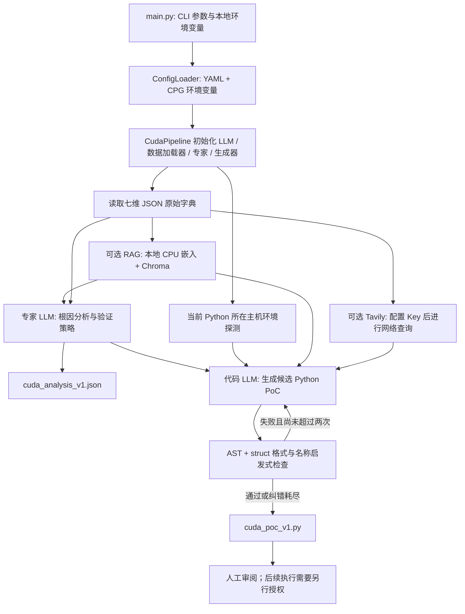
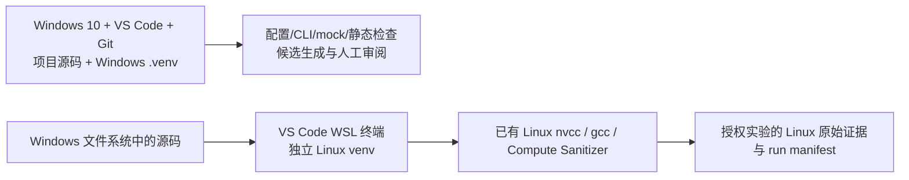

# P0 基线审计与增量开发路线

审计日期：2026-10-14。基线分支：`main`；基线 HEAD：`321e804ba5fd0d1d1f05b5ded02f5022a80683ac`。规范化工作分支：`feature/p0-venv-baseline-audit`。

本报告记录修改前的真实实现。下文源码行号均对应上述基线提交；规范化后的文件行号可能变化。修改前工作区只有用户对 `.env.example` 的修改，暂存区为空。该用户修改应保留，不能以覆盖工作区的方式恢复基线。修改后的测试、Commit 和 PR 状态以 [P0 验收记录](P0_VALIDATION.md) 为准。

## A. 真实架构与完整数据流

当前实现是 **Single-shot Generation**：一次漏洞分析、一次候选代码生成，以及最多两次基于静态检查结果的代码纠错请求。静态纠错属于生成阶段，不是执行后的漏洞反馈迭代。主流水线不运行生成的 PoC，不自动编译它，也没有漏洞验证器、人工反馈解析器或 benchmark 执行器。



1. `main.py:21-28` 尝试加载项目根目录 `.env`，`main.py:41` 在解析 CLI 之前导入流水线，因此裸解释器缺依赖时连 `--help` 都失败。CLI 接受 `--config`、`--cve-id`、`--input-dir`、`--output-dir`、`--no-rag`、`--log-level`；输入互斥检查位于 `main.py:79-98`。没有 `--max-iter`。
2. `CudaPipeline.__init__`（`src/pipeline.py:35-47`）加载配置，立即构造 LLM 客户端，再构造数据加载器、CUDA 辅助知识库、专家和生成器。默认输入/输出路径相对于项目根目录；命令行自定义相对目录则依赖启动工作目录。
3. `load_inputs`（`src/data_loader.py:105-136`）按配置读取七个 JSON 文件，保留文件的原始嵌套结构。缺文件或非法 JSON 会得到空字典。流水线仅拒绝七维全部为空的情况（`src/pipeline.py:77-80`），不会要求七维齐全或核对全部 CVE ID。
4. RAG（`src/data_loader.py:141-273`）只加载 `.md`、`.txt`，使用 `sentence-transformers/all-MiniLM-L6-v2` 的本地 CPU 嵌入，首次可能联网下载模型，向量索引持久化至 `data/knowledge_bases/.chromadb`。查询结果作为文本注入专家提示。它不是在线漏洞情报数据库，也没有索引版本/内容变更自动失效机制。
5. Tavily（`src/pipeline.py:176-193`、`src/tools/search.py:19-50`）在 `TAVILY_API_KEY` 已配置时自动查询该 CVE，最多取三条结果。它与 RAG 独立；`--no-rag` 不禁止 Tavily 网络调用。网页摘要只加入代码生成上下文，未加入专家分析调用。
6. 环境探测（`src/pipeline.py:99-106`）调用当前宿主进程的 `probe_environment()`。Windows 启动时探测 Windows；没有自动连接 WSL、路径转换或分别保存两个环境的机制。Linux 探测可额外编译一个无害空 kernel 进行 nvcc 冒烟检查；Windows 分支不会执行该 smoke。
7. 专家（`src/core_expert.py:243-283`）将七维输入和 RAG 文本交给 LLM，要求输出 `root_cause_analysis` 与 `verification_strategy`。schema 仅作为提示文字；只检查顶层键存在并记录警告，不调用真实 schema 校验。实测环境和 Tavily 上下文未进入该专家调用。
8. `cuda_analysis_v1.json`（`src/pipeline.py:118`）保存模型分析。代码生成上下文包含分析、OS/CUDA/组件输入、辅助函数签名、工具参考、探测环境、截断至 1500 字符的 RAG 和 1000 字符的网页摘要（`src/pipeline.py:127-133`，`src/code_generator.py:290-361`）。
9. 生成器（`src/code_generator.py:239-285`）清除代码围栏并检查 AST、struct 格式和名称引用，失败时最多再请求模型两次；纠错耗尽后仍保存代码。结果固定为 `cuda_poc_v1.py`，重跑同一 CVE 会覆盖同名分析与代码，没有 `run_id` 或哈希记录。
10. 主流程只打印人工执行命令（`src/pipeline.py:135-139`）。`src/tools` 确实提供编译、二进制解析和工具执行函数，但主流程只将它们的部分说明注入提示，并未因此自动执行验证。

当前默认输出仅有模型分析 JSON 和候选 Python 源码。没有原始执行证据收集系统，也没有已实现的证据与分析混存流程。由于输出目录没有产物分类或运行清单，人工拷入的日志、二进制和模型文件未来可能混在一起，需要增量建立存储边界。

## B. 已有能力、输入输出与复用边界

| 能力及实现位置 | 输入 | 输出 | 真实能力边界与复用建议 |
| --- | --- | --- | --- |
| CLI：`main.py:45-104` | 命令行参数 | 输入/输出路径及流水线启动 | 保留参数；将帮助解析与重依赖导入分离 |
| 配置：`src/config_loader.py:50-121` | YAML、`.env`、`CPG_*` 环境变量 | 配置字典、根目录路径 | 保留 YAML 和 env 覆盖；增加类型/范围与明确错误校验 |
| 七维加载：`src/data_loader.py:105-136` | 七个 JSON 文件 | 原始七维字典 | 兼容已有 flat/wrapped 两种格式；尚未验证完整性与语义 |
| CUDA 专项专家：`src/core_expert.py:243-283` | 七维数据、RAG、可选反馈参数 | 模型根因分析与验证策略 | 七层模型是 Prompt 设计，不是七个独立验证算法；保留 Prompt 与领域分类 |
| LLM 调用：`src/llm_client.py:126-201` | 对话消息、模型配置 | 文本回复 | 已有超时和有限重试；调用成功不证明输出事实正确 |
| JSON 提取：`src/llm_client.py:255-336` | 模型文本、提示中的 schema | 字典，失败则 `{"raw": ...}` | 只有 JSON 提取；不存在接入流水线的结构校验 |
| 候选生成：`src/code_generator.py:222-285` | 模型分析、CUDA 输入和上下文 | Python 候选文件 | 保留生成与两次静态纠错；不会检查 CUDA 语义、编译或运行结果 |
| 静态检查：`src/code_generator.py:388-449` | 候选源码 | `(ok, error)` | AST 与启发式名称分析；不检查模块是否可导入、函数签名、作用域和真实执行 |
| RAG：`src/data_loader.py:141-331` | 本地文档、嵌入模型、查询 | 检索文本或带元数据结果 | 保留 CPU RAG；需补来源可信度、索引身份、分块参数校验和离线策略 |
| CUDA 辅助知识：`src/cuda_library.py` | 查询/类别 | 函数签名、错误码和参考代码文本 | 签名并不都对应可执行函数；复用知识结构并复核内容 |
| 环境探测：`src/env_probe.py:25-58` | 当前进程所在宿主机 | OS/GPU/工具链/编译器字典 | 保留跨平台探测框架；当前含硬编码默认值，不能当目标 WSL 的实测报告 |
| 工具定位：`src/tools/env.py:14-186` | 工具名、当前环境 | 工具路径、版本/架构、MSVC 环境 | 标准库实现可复用；应明确未知值、发行版本与 Driver API 版本的区别 |
| 编译封装：`src/tools/compile.py:18-120` | `.cu`、输出路径、arch/flags | cubin 路径或异常 | 可复用接口；当前 shell 拼接、日志截断、固定临时名需要修正 |
| ELF 操作：`src/tools/elf_ops.py:37-283` | ELF64 bytes、section/字段 | 元信息、修改 bytes、问题列表 | 保留字节操作库；修复字段宽度、边界/格式校验后再依赖其结果 |
| 二进制工具检查：`src/tools/inspect.py:18-95` | cubin 文件、timeout | 工具输出、exit code、崩溃启发式 | 工具包装不是漏洞 oracle；当前退出状态语义还有错误 |
| Tavily：`src/tools/search.py:14-94` | CVE/组件关键词、环境中的 Key | title/url/content 摘要 | 保留可选情报接口；需声明依赖、联网开关与来源记录 |
| 现有测试：`tests/test_cli.py:6-46` | 六种 CLI 参数情况 | unittest 断言 | 只测 CLI；未覆盖配置、LLM、schema、RAG、工具与执行证据 |

### 七维输入与已有案例

只读 JSON 检查确认：六个案例各有七个文件，共 **42 个 JSON**；均可解析、文件名齐全，同一目录的 `cve_id` 一致。该结果只证明文件结构与 ID 的一致性，不证明 CVE 描述、受影响版本、根因或触发条件真实。

| 案例 | 仓库描述 | 格式与研究边界 |
| --- | --- | --- |
| CVE-2022-21821 | cuobjdump 整数溢出 | D1-D4/D6 扁平；D5/D7 嵌套；根因细节泛化，`7_root_cause.json:10` 的修复说明有占位式措辞 |
| CVE-2023-0196 | cuobjdump NULL dereference | 同上；`5_vulnerability_type.json:9` 含 `C:L`，`7_root_cause.json:4` 却称无机密性影响，应复核内部不一致 |
| CVE-2024-0076 | cuobjdump / nvdisasm 越界读 | 同上；`4_attack_surface.json:5` 的 `cuobjdump + nvdisasm` 是组件合写，不能直接视为有效 shell 命令 |
| CVE-2024-0124 | nvdisasm UAF | 七维均用领域包装；`7_root_cause.json:10-16` 明确含推测触发条件/修复方式，不应升级为已证实事实 |
| CVE-2025-23308 | nvdisasm REL section 堆溢出 | D1-D4/D6 扁平；D5/D7 嵌套；含二进制地址、Valgrind 描述和跨版本/跨 OS 外推，未附本仓库运行证据 |
| CVE-2025-23339 | cuobjdump DWARF 栈溢出 | 七维均用领域包装；含具体地址/栈帧/披露时间，但版本外推与“tested_environment”不能代替当前实验记录 |

所有 D5/D7 都有嵌套对象；CVE-2024-0124、CVE-2025-23339 的 D1-D4/D6 也嵌套，其余案例的这些维度扁平。输入模型 `src/models/vulnerability.py:9-80` 未接入加载流程，不能据文件存在而宣称全部字段已校验。P1 应加入兼容归一化，保留原始输入，避免字段被默认值或 `extra=ignore` 静默丢弃。

六个案例均描述用户态二进制工具攻击面，不能作为 CUDA Driver、GPU kernel、IPC、虚拟化等覆盖能力的实验依据。知识库只有一个受控种子 Markdown；其 CVE 案例、`GPU 无 MMU 保护` 等表述和修复版本需要逐项核对原始来源。README 宣称内置完整 CVE-2025-23247 输入，但目录中没有该案例；只有知识库中的文字描述。

本轮 **未访问案例引用公告、NVD 或 Talos 页面，也未复核其真实根因与版本范围**，统一标记 `NOT_CHECKED`。本报告不把资料中的 Valgrind、RIP 或测试环境描述记作本轮实验结果。

### 依赖分类

| 分类 | 基线依赖与使用情况 | P0 策略 |
| --- | --- | --- |
| 核心运行 | PyYAML、python-dotenv、langchain-core、langchain-openai；代码直接使用 httpx，但未在 requirements 单列；Pydantic 提供已有模型 | 通过 `pyproject.toml` 明列直接依赖，保留现有 LLM 封装和模型 |
| RAG 可选 | langchain-chroma、langchain-huggingface、chromadb、sentence-transformers；torch 为传递依赖 | 拆为 `rag` extra；本地 CPU 嵌入，不要求 Windows CUDA 安装 |
| 搜索可选 | 代码导入 `tavily`，requirements 未声明 | 拆为 `search` extra，文档说明有 Key 会触发联网 |
| 开发/测试 | 原测试仅 unittest，无独立开发依赖组 | 拆为 `dev` extra，新增离线 mock 测试与必要检查工具 |
| 未直接使用/传递依赖 | langchain 聚合包、langchain-community、langchain-text-splitters、rich、click 未被业务直接导入；openai、tiktoken、langsmith 主要由 LangChain 引入 | 只移除确认不直接需要的默认安装项，不删除对应 RAG/追踪功能；保留必要版本约束 |
| 平台专项 | `src/tools` 主要标准库实现；Linux CUDA/gcc/Compute Sanitizer 是系统工具 | 不把 GPU 驱动或 Toolkit 当 pip 依赖；两平台分别记录 Python 依赖与系统工具 |

基线 requirements 全为无上界 `>=`，没有锁定文件，不能称可复现。P0 应固定 Python 基准，限制兼容系列，记录实际解析和安装版本；锁定需要区分平台与 extras。规范化的 Python 支持范围为 `>=3.10,<3.13`，Windows 基准为 3.12。`constraints/core.txt` 固定既有核心 LangChain/OpenAI 基准，避免把迁移混入核心大版本升级。原 RAG 的 0.x 最低依赖与既有 LangChain 1.x 核心存在兼容疑问，计划采用最低兼容的 1.0 系列集成；其 PyPI 元数据匹配不能替代实际安装/导入或端到端运行。修改后具体安装版本、失败或尚未验证的组合以验收报告为准。

## C. 修改前问题清单

严重程度用于工程可靠性排序：高表示会损害证据可信度、主链正确性或凭证边界；中表示影响兼容性、维护和故障定位；低表示文档/提示清晰度。它不是已验证漏洞的 CVSS 分数。

| 编号 / 程度 | 基线位置 | 原因与实际影响 | 增量修复建议 |
| --- | --- | --- | --- |
| C01 高 | `README.md:20,159-229,375,385-413`；`src/pipeline.py:7-13,131` | README 宣传五阶段、用户反馈解析、最多十轮迭代，并列出不存在的 `feedback_loop.py`；实际只生成 v1 | P0 重写为三阶段 Single-shot Generation，计划能力明确列入路线 |
| C02 高 | `src/llm_client.py:278-291,297-336`；`src/core_expert.py:269-283`；`src/models/analysis.py:7-37` | schema 仅注入 Prompt；JSON 合法不等于字段/类型合法，解析失败原始文本可继续进入生成；现有 Pydantic 模型多数字段默认空值，直接接入仍会接受空分析 | P1 收紧必需字段后接入严格结构校验，错误单独记录，拒绝无效分析继续生成；保留原文用于诊断 |
| C03 高 | `src/env_probe.py:81-83,225,243-248,616-642` | 所有 GPU 被赋为 SM7.5；nvcc 缺失也返回 CUDA11.x 架构列表，随后标为真实目标环境 | P1 把 observed / configured / fallback / unknown 分开；无设备不宣称实测架构，nvcc 无法查询时保持 unknown |
| C04 高 | `src/pipeline.py:99-106`；`src/env_probe.py:25-58` | 没有 dev host / execution target 身份，Windows 探测进入 WSL 候选生成提示 | P0 文档明确双环境；P2 引入可选目标环境快照与 backend 身份，不假定 Windows DLL 可跨到 Linux |
| C05 高 | `src/core_expert.py:108-110`；`src/code_generator.py:163`；`src/tools/inspect.py:92-95` | Prompt 容许 CUDA 错误码成为成功条件、要求“触发即 exit0”；崩溃 helper 不能识别具体 CVE | 当前主流程没有漏洞成功判定逻辑；P3 增加目标规则与匹配证据，区分程序错误、候选异常与 CVE 确认 |
| C06 高 | `src/code_generator.py:250-282,388-449` | AST/名称检查只静态验证；纠错耗尽仍保存，调用方继续输出“已生成”，未携带质量状态 | P0 如实说明；P1 产物记录静态结果和未通过状态，不让用户将保存文件误认为可执行成功 |
| C07 高 | `src/tools/elf_ops.py:261-271` | ELF64 字段宽度选择错误：实际仅 sh_name/sh_type/sh_link/sh_info 为32位；sh_flags/sh_addr 为64位 | P1 按字段宽度修复，使用受控 ELF fixture 检查相邻字段不会被覆盖；不运行畸形二进制 |
| C08 高 | `src/tools/compile.py:44-58` | arch/extra_flags/路径拼接后 `shell=True`，存在参数注入和 Windows/POSIX quoting 风险 | P1 命令参数列表化、校验 flags；MSVC 环境准备与 nvcc 执行分开 |
| C09 高 | `src/pipeline.py:118,135`；`src/code_generator.py:280-282` | 重跑覆盖 v1；没有运行 ID、源码/输入/工具哈希、原始 stdout/stderr 或退出身份 | P2 使用 run 目录和 manifest；候选/模型输出/raw evidence 分开，原始证据不可被模型改写 |
| C10 中 | `README.md:297-319`；`config/default.yaml:7-15`；`src/llm_client.py:73-80,233-245` | README/注释说 NIUBI，YAML 实际为 DeepSeek；Key 变量与示例/错误文案不统一，超时注释提到另一模型 | P0 统一官方 DeepSeek 默认及 env 名，保留旧 Key 名显式兼容；不盲改已确认可用模型 |
| C11 中 | `main.py:41`；`src/llm_client.py:22-24,65-70` | 解析 CLI 前导入完整依赖；后置 ImportError 处理不能覆盖顶层导入失败 | P0 延迟流水线导入，`--help` 不要求 Key/RAG/LLM 依赖，正常运行缺依赖时明确报错 |
| C12 中 | `src/config_loader.py:25-32,62-84`；`main.py:21-28` | 双重 `.env` 加载、隐式目录搜索；非法 env 数字和非 mapping YAML 抛底层异常 | P0 统一根目录或显式 dotenv 路径、真实环境变量优先、严格布尔/范围/类型错误消息 |
| C13 中 | `src/llm_client.py:148-174,207-219` | assistant 消息转 HumanMessage；覆盖温度时新模型丢失 max_tokens；所有无 status_code 异常都重试 | P1 保留对话角色与生成参数，用类型区分瞬时网络问题与解析/程序错误 |
| C14 中 | `src/data_loader.py:105-136`；`src/pipeline.py:77-80,196-203` | 缺维度/非法 JSON 不硬失败、取首个 CVE、不核对七文件；存在模型但未使用 | P1 兼容归一化后校验完整性、CVE 一致性与最小有效信息，保留可显式选择的部分输入模式 |
| C15 中 | `src/pipeline.py:156-167` | 嵌套 vulnerability_type 被 stringify 为 CWE；nested 组件、架构、根因摘要无法读取 | P1 用归一化模型构造检索查询；对两种现有格式增加回归 fixture |
| C16 中 | `src/data_loader.py:76-78,175-188,210-225,293-295` | overlap >= size 可死循环；固定嵌入模型；失败降级信息分散；目录存在即加载索引；top_k 修改不恢复 | P0 检查分块边界并明确降级；P1 支持离线嵌入路径、索引 hash/model 身份、top_k 局部作用 |
| C17 中 | `src/env_probe.py:115,334,344,466,539-576` | smoke 未运行默认 false 却显示 FAILED；Windows 直接返回，Linux自动编译，超时路径可能残留临时文件 | P1 使用 NOT_RUN/PASS/FAILED 状态，主动 smoke 与被动信息探测分离，finally 清理 |
| C18 中 | `src/tools/env.py:104-127,130-145` | 把 nvidia-smi 驱动发行号拼成 Driver API 版本；工具 helper 的 sm52 fallback 与探测器的 sm75 不一致 | P1 driver_release 与 driver_api_version 分字段，未知架构不伪装实测 |
| C19 中 | `src/tools/inspect.py:31-36,59-68,95` | cuobjdump timeout 未捕获；nvdisasm 任意正常返回都 ok=True；Linux -11/-6 不被识别 | P1 标准化 process result、timeout、signal 与 returncode；保留完整原文，不直接判断 CVE |
| C20 中 | `src/tools/compile.py:63-64,73-89`；`src/tools/elf_ops.py:176-206,231-249` | 编译日志截断；临时源删除却返回该路径；固定工作文件名；ELF 校验只检查首100节且缺 class/endian 验证 | P1 先修 helper 正确性，再 P2 统一产物与完整日志；ELF 结构检查仍只检查结构 |
| C21 中 | `src/code_generator.py:335-336`；`src/tools/__init__.py:71-80` | 工具说明截断800字符可能切掉 import；项目根目录固定四层，用户自定义 output-dir 后会失效 | P1 保留完整关键 import 说明，显式传 project_root 或安装包入口 |
| C22 中 | `requirements.txt:5-25`；`src/tools/search.py:34` | 所有依赖无限上界、核心/RAG混装、多项未直接使用、Tavily依赖缺失 | P0 pyproject + extras + 兼容系列约束，分别安装验证，避免算法迁移同时全量升级 |
| C23 中 | `data/inputs/**`；知识库 `cuda_vulnerability_knowledge.md:18,140-158,162-165` | 研究事实、推测、历史环境和未经本轮复核的实验描述未有统一 provenance；知识库还宣称已实现反馈行为 | P1 引入 source、版本、置信层级与假设；P0 文档标示输入是研究资料、未复核，不以其“tested”作为验收 |
| C24 中 | 基线 Git 跟踪清单中的 `.workbuddy/` | 本地工作记忆已跟踪，忽略规则无法自动解除现有跟踪，可能含本地主机信息 | P0 先审计再仅移出索引，保留用户本地文件；历史不重写，报告限制 |
| C25 低 | `README.md:333-337,375,436-438` | README 的参数示例缺少必要输入，列出不存在参数/文件，结尾有22个NUL字节 | P0 按真实 CLI 重写并用实际命令检查文档；清除损坏尾部 |
| C26 中 | `tests/test_cli.py:6-46` | 六个 CLI 测试未覆盖主链 schema、mock LLM、错误处理、配置/ignore 和跨平台工具 | P0 增加非网络回归测试；P1/P2 再随能力补相应结构与backend测试 |

官方 DeepSeek 文档在 2026-10-14 被主审计核对，当前配置的 `deepseek-flash` 模型名可保留；问题是 provider 说明、Key 变量与错误提示的不一致。本轮未向模型 API 发请求。[官方模型与接口文档](https://api-docs.deepseek.com/zh-cn/)

## D. Windows 主开发与 WSL CUDA 后端



- Windows `.venv` 只承担开发、CLI、配置、LLM 和可选 CPU RAG。VS Code 默认解释器为 `${workspaceFolder}\\.venv\\Scripts\\python.exe`。不依赖 Conda base，保留旧 Conda 环境。
- WSL 使用自身 Python 与 `/home/pocdev/.venvs/cuda-poc-generator`。不能激活或执行 Windows `.venv`，不能认为 Windows Python 可以调用 WSL 的 `libcuda.so`。两边独立安装 Python 包，锁定和验证也分别进行。
- 源码可以在 Windows 文件系统，通过 WSL 的挂载路径访问；不要把 Linux venv 放到 Windows `.venv` 或复用其 site-packages。后续实验工作目录优先设在 Linux 文件系统，输出路径在 manifest 中明确记录。
- GPU/工具环境描述由 WSL 独立采集，记录其 OS、Python、nvcc、gcc、工具路径/版本与运行身份。Windows 环境记录另存，不与 Linux 目标字段互相覆盖。未知值保持 unknown；用户设置的 GTX1660/SM7.5 是配置前提，只有探测证据可标记为 observed。
- P0 不安装 CUDA 驱动、Toolkit，不修改 WSL 网络、GPU 驱动或旧 Conda。尚未实施跨 Windows/WSL 自动执行接口。真实 PoC 不在本轮运行。

规范化安装命令以重写后的 README 为准。以下为双环境的执行方式；其中 extras 依赖实际安装结果需查验收记录。

Windows PowerShell（项目根目录）：

```powershell
py -3.12 -m venv .venv
.\.venv\Scripts\python.exe -m pip install -c constraints/windows-py312.txt -e ".[dev]"
.\.venv\Scripts\python.exe main.py --help
.\.venv\Scripts\python.exe -m unittest discover -s tests -v
# 可选 CPU RAG；首次嵌入模型下载仍可能联网
.\.venv\Scripts\python.exe -m pip install -c constraints/core.txt -e ".[rag]"
```

WSL 终端（已存在 `pocdev` 账户时；先检查 WSL 自身 Python 版本）：

```bash
python3 --version
mkdir -p /home/pocdev/.venvs
python3 -m venv /home/pocdev/.venvs/cuda-poc-generator
source /home/pocdev/.venvs/cuda-poc-generator/bin/activate
# cd 到通过 WSL 挂载访问的项目目录，再独立安装 Python 包
python -m pip install -c constraints/wsl-py310.txt -e '.[dev]'
python main.py --help
python -m unittest discover -s tests -v
```

Windows 基准为 Python 3.12.13；本轮只读检查的 WSL Ubuntu 22.04 自身 Python 为 3.10.12，未找到 Python 3.12。因此 WSL 可使用已存在且在支持范围内的 3.10 创建独立 venv，单独验收，不声称与 Windows Python 版本一致；本轮没有自动升级 Linux Python。不得因 venv 缺失而回退到 Conda base。只读检查还确认 `/usr/local/cuda-12.8/bin` 中有 CUDA Toolkit 12.8.93 和 Compute Sanitizer 2025.1.0.0；该目录不在本轮非 login shell 的 PATH 中，后续应明确使用已安装工具的绝对路径或在 WSL 终端显式配置 PATH，不重装 Toolkit。这些工具版本检查没有执行 GPU kernel 或真实漏洞样本。

当前 CLI 的生成命令是 `python main.py --cve-id <现有案例> --no-rag`，仍需要模型 Key，并可能调用已配置的 Tavily。它产生候选文件，不执行样本。WSL CUDA 测试先仅针对人工审查的无害 smoke；真实漏洞候选的执行要由后续授权与隔离策略决定。

## E. P0-P5 增量接口与可执行验收

已有 `CudaSecurityExpert`、`CudaCodeGenerator`、`LLMClient`、`CudaDataLoader`、`CudaLibrary` 和标准库 helper 应保留，在其周围补接口和证据系统，避免重写另一套框架。以下均是计划验收条件，不能据本报告视为已经实现。

| 阶段 | 增量范围与模块接口 | 可执行验收标准 |
| --- | --- | --- |
| P0 稳定工程基础 | `ConfigLoader` 保留 YAML/env 兼容；`pyproject.toml` 核心/rag/search/dev；README、ignore、VS Code venv；错误提示与离线测试 | Windows `.venv` 安装/导入并 `pip check`；`main.py --help`、现有六CLI用例及新增配置/Mock测试通过；受控JSON/MD/CUDA fixture可跟踪、产物被ignore；`git diff --check`；索引与历史敏感审计，真实API/GPU/RAG未运行项明确NOT_CHECKED |
| P1 代码生成质量 | `normalize_input(raw) -> NormalizedInput`；`validate_analysis(raw) -> ExpertAnalysis`；`generate(...) -> CandidateArtifact`，附 static_result/provenance；保持现有专家/生成器 Prompt，先修 helper | 六案例两种格式都加载且不丢关键字段；缺字段、错误类型、CVE冲突失败；离线Mock覆盖合法分析/非JSON/伪分析拒绝、静态纠错上限、错误产物状态；ELF受控fixture证明字段宽度正确；无API/PoC执行 |
| P2 编译/执行后端与原始证据 | `ExecutionBackend.probe/compile/run`；`RunRequest` 含授权配置、参数列表、timeout、隔离目录；`ProcessResult` 含 stdout/stderr/returncode/signal/timing；`EvidenceStore` 与 run manifest | 先用无害Linux smoke编译执行；Windows启动不加载Linux库；缺工具/超时/非零返回/signal均由Mock覆盖；每次run有独立ID、输入/源码/二进制/日志hash与backend身份；原始日志完整保留、模型无写证据权限；实际WSL检查单独记录 |
| P3 基于目标条件的验证 | `VerificationSpec` 描述受影响组件/版本、前置条件、目标原语、必须/排除证据；`Verifier.evaluate(spec, evidence) -> Verdict` | 对无害固定日志fixture分别得 confirmed/not_reproduced/inconclusive；单独crash、exit0、CUDA700、编译成功、LLM说成功都不得confirmed；证据不足、版本不明或hash不匹配返回inconclusive；人工复核每个confirmed的目标匹配依据 |
| P4 有界反馈与可复现迭代 | `IterationController` 连接现有专家/生成器、ProcessResult、Verdict；预算含最大轮数/模型请求/运行时间/token/cost；新候选不覆盖旧run | 离线脚本化Mock覆盖修正后成功、连续失败、网络失败、超时、预算耗尽、用户终止；检查总请求与执行数未越界；重放保存的输入/配置/提示/证据得相同判定；执行反馈与静态纠错分别计数 |
| P5 Benchmark 与科研评估 | `BenchmarkCase/Manifest/Runner/Metrics`；受控案例、明确split与目标环境，单次生成和迭代对照，保存每次run身份 | 离线fixture能算解析率/静态通过率/编译率/执行率/目标确认率及成本/轮数；分母含失败与inconclusive，不把异常率当验证率；实际实验预先固定案例、版本、随机种子/采样参数和预算，授权后执行；提供原始证据与可复算指标，不编造GPU/API成绩 |

建议数据对象至少包含：

- `NormalizedInput`：原始七维输入引用、统一字段、来源、来源日期、affected_version 声明、assumptions；不混入当前实测环境。
- `EnvironmentSnapshot`：`snapshot_id`、`backend_id`、platform、Python/工具版本、每字段 source/status、采集时间；Windows dev 和 WSL target 独立记录。
- `CandidateArtifact`：`candidate_id`、源码路径/hash、输入与分析 hash、model/prompt/config 身份、静态结果；模型生成信息放在 model 子目录。
- `ProcessResult`：`run_id`、候选/backend 身份、argv、cwd、开始/结束时间、timeout、returncode/signal、原始 stdout/stderr 路径/hash；禁止模型覆盖。
- `Verdict`：枚举状态、所用 VerificationSpec 版本、匹配证据引用、缺失/排除条件；LLM 解释可附加，不能替代规则与原始证据。

建议后续目录：`runs/<run_id>/candidate/`、`model/`、`raw/`、`derived/` 与 `manifest.json`。原始私有日志默认忽略；提交 benchmark 只纳入审查后的固定 fixture 与可公开 manifest，不纳入绝对路径、GPU UUID、凭证或私有环境原文。

## F. P0 最小修改建议与基线测试记录

本阶段可实施的修改限定为：独立分支上建立 pyproject/extras 与 `.venv` 安装方式；明确且兼容的 Key/env 配置；CLI 帮助的延迟导入；配置类型/范围校验与清晰错误；README 准确描述；精细 `.gitignore`；移出已跟踪的本地工作记忆索引并保留本地文件；增加配置/CLI/非网络 Mock 回归。保留七维原始资料、CUDA 专家 Prompt、RAG 读取与生成算法。ELF/进程结果/目标验证的业务修正另列 P1-P3，不能包装成已经完成的 P0 能力。

`.gitignore` 应按路径区分运行产物与研究源文件：保留 `data/inputs/**`、`data/knowledge_bases/cuda/**` 和受控 fixtures；忽略 `.venv/`、常见 venv/Conda 本地目录、`.env`/凭证/本地配置、Python/pytest/ruff/mypy缓存、build/dist/egg-info、本地编辑器临时文件、`data/outputs/`、Chroma 索引、raw/model调用日志、benchmark运行目录与CUDA临时二进制。不能忽略整个 `data/` 或全局屏蔽 `.json`、`.cu`、`.cubin`、`.log`。新增 ignore 不会自动停止跟踪已有文件，必须单独核对 `git ls-files`。

| 修改前检查 | 状态 | 事实与限制 |
| --- | --- | --- |
| 分支 / HEAD / 工作区 / 暂存区 | PASS | `main` 与上述完整SHA；工作区仅用户 `.env.example` 修改，暂存区为空 |
| Python 3.12.13 标准库 AST | PASS | 24个受控Python文件可解析；有2个 SyntaxWarning，需保留为警告记录；不等于运行验证 |
| 裸解释器核心依赖导入 | FAILED | 项目需要的核心第三方依赖缺失；不是生成算法已通过/失败的依据 |
| 裸解释器 CLI help | FAILED | 提前导入流水线导致 ModuleNotFoundError |
| 原有六个 unittest | FAILED | 均受 ModuleNotFoundError 阻断，不能称CLI行为已经验证 |
| 原始HEAD隔离副本在core/dev依赖下的CLI与六个测试 | PASS | `git archive` 的原始HEAD在不含`.env`的隔离副本中：help与六个unittest均通过；说明最初裸解释器失败由缺依赖引起，不能归因于原CLI逻辑失效 |
| 六案例42个JSON / 文件完整性 / CVE ID | PASS | 只读解析通过；同一目录ID一致；未检查来源真实性 |
| README 编码尾部 | FAILED | 检出22个NUL字节，基线README有损坏尾部 |
| 当前 index/worktree 与两个可达commit敏感扫描 | PASS（有限） | 仅匹配示例placeholder，未发现实际Key；`.env`未跟踪；有限规则不能证明从未泄漏，`.workbuddy`已跟踪需解除索引 |
| 官方模型名文档核对 | PASS（配置资料） | `deepseek-flash` 在官方文档中可用；未进行鉴权或真实模型请求 |
| 官方CVE / 受影响版本 / 根因来源核对 | NOT_CHECKED | 未访问并复核公告/NVD/Talos；现有输入仍按未验证研究资料处理 |
| 真实LLM / Tavily请求与成本 | NOT_CHECKED | 本轮未发请求，不产生模型调用成本，也不声称API可用性已实测 |
| 真实RAG模型下载、嵌入/索引/检索 | NOT_CHECKED | 本轮未为基线下载模型或构建索引；Mock不等于真实端到端RAG |
| WSL只读Python / Toolkit / Compute Sanitizer版本 | PASS（只读） | Python3.10.12、nvcc12.8.93、Compute Sanitizer2025.1.0.0；不等于Linux依赖安装或CUDA运行验收 |
| WSL虚拟环境安装 | NOT_CHECKED（初始基线） | 随后的独立Linux venv核心/dev安装与离线回归已完成，结果见验收报告 |
| GPU实测/运行 | NOT_CHECKED | 工具版本读取不等于GPU实验；未执行GPU smoke或漏洞样本 |
| 真实漏洞PoC / 提权 / 破坏性样本 | NOT_CHECKED | 按用户边界不执行 |
| CUDA无害编译/运行 | NOT_CHECKED | 本轮仅调用nvcc --version，未执行编译或GPU smoke，源代码审阅不等于工具链验证 |

提交前应仅暂存审查后的工程文件，核对 staged diff、ignore 命中、敏感扫描和 whitespace；不提交 venv、Key、私有日志、缓存或二进制。不重写稳定历史，不 force push，不自行合并 PR，不改稳定标签，不修改已暂停的 HeteroPoCLab。

现有生成能力的保留结论必须限定为离线回归与接口兼容：如真实API/RAG/GPU未测试，应在最终验收记录明确写 `NOT_CHECKED`，不能由 mock 测试推导真实漏洞已复现。优先进入 P1 的工作是输入归一化、schema接入、静态结果状态、ELF helper正确性、消息/参数保留与探测值真实性；这些改进均围绕原生成链逐步加入。
