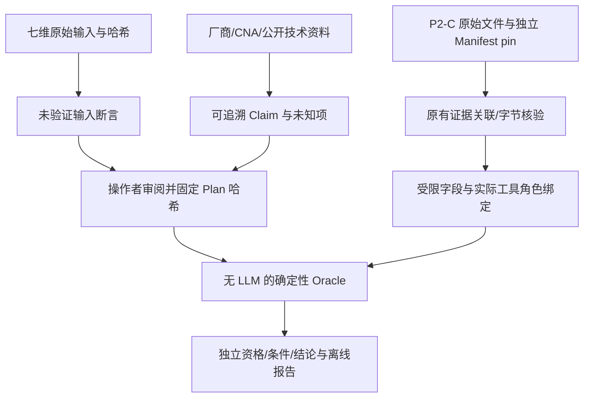

# P3-A：目标条件与离线 Oracle 合同 v1.0

本阶段基于 `main@f1e3bc98322b23f87830e229a912acb8ff0bda17`，只增加来源审查、离线确定性判定和报告。没有启动候选、CVE 样本、畸形 native parser 输入、GPU kernel 或付费模型请求。旧生成 Prompt、42 个原始输入、P2 执行合同和历史报告不改写。

## 真实数据流

原生成链保持：七维 JSON → P1-A 归一化/一致性检查 → CUDA 专家 LLM → 严格分析合同 → 单次生成 → 静态检查。P2-C 独立入口仍只支持已注册、明确授权的无害工具动作。

新增链：七维原文件及其 SHA-256 → 输入断言；公开资料审查 → 来源限定的 VulnerabilityClaim；操作者审阅并独立固定 OraclePlan SHA-256；独立固定旧 EvidenceManifest 原始字节 SHA-256 → P2-C 原有证据读取器 → 不可变 EvidenceCorpus → EvidenceReference 精确取值 → 条件判定 → OracleResult → 确定性报告。此链不调用生成或执行入口。



## 模型与接口

| 位置 | 接口 | 约束 |
| --- | --- | --- |
| `src/models/oracle.py` | SourceDocument / InputAssertion | 厂商、CNA、技术分析、实测、LLM、用户、合成来源分开；输入保留文件/字段路径/原始 SHA，不变成实测 |
| 同上 | VulnerabilityClaim | CVE/CWE/组件/版本命名空间/入口/受控输入/前提/机制/客观行为/修复/来源/未知项；文献支持不等于复现 |
| 同上 | TriggerCondition / EvidenceRequirement | 条件分类、谓词、subject、预期值或关系、适用性、必要性、来源、证据类型/方法/scope、初始 PENDING |
| 同上 | EvidenceReference | 原始文件+SHA+JSON Pointer，request/run/platform/probe/snapshot/input/toolrole/toolSHA/collector/source/scope |
| 同上 | OraclePlan | 版本化、目标 CVE、预定义标准、所有必要条件、来源和完整身份绑定；生产草案另绑定 claim SHA |
| 同上 | CVEEligibility / ConditionEvaluation / OracleResult | 资格、逐条件与总结果独立；不授予执行授权 |
| `src/oracle_catalog.py` | load_reviewed_claim(cve_id) | 只支持六个已审查案例，复用 normalize_input_files，输入断言仍 UNVERIFIED |
| 同上 | smoke_review_plan(claim, corpus) | 仅生成供审阅草案；不会自动批准 plan hash |
| `src/oracle_evidence.py` | load_p2c_evidence(folder, expected_manifest_sha256=...) | 固定只读 adapter；原有 reader 负责请求/授权/执行/平台/原始包/native 证据关联 |
| 同上 | EvidenceCorpus.resolve / validate_tool_binding | 对原始 JSON 字节重新核对 SHA、严格 JSON Pointer、字段白名单、实际步骤工具角色 |
| `src/oracle.py` | evaluate_oracle(plan, corpus, trusted_plan_sha256=...) | 无网络/LLM/子进程；未 pin 或身份冲突 fail-closed |
| `src/oracle_report.py` | render / save / rebuild_oracle_report | 不修改判定；独占新目录、文件字节索引、离线重建 |
| `src/oracle_cli.py` | claim / prepare-smoke-review / evaluate / synthetic / rebuild-report | 新独立模块入口；不修改已有 main.py CLI |

所有 P3 Pydantic 合同继承严格、禁止额外字段、禁止 NaN/Infinity、frozen 及嵌套重校验的合同。`model_copy(update=...)` 不会绕过调用边界上的重校验。列表冻结不是安全隔离；每次使用均重校验，调用者进程仍须可信。

## 来源与资格

厂商/CNA/技术分析属于公开文献支持，不是本机执行事实。`SourceDocument.support=DOCUMENTED` 不表示根因得到实测证明；LLM_REASONING 或 USER_ASSERTION 单独不足以构建 DOCUMENTED_NOT_REPRODUCED claim。输入断言分类是保守导入策略，不能据此推断原文件实际作者是人还是模型。

来源字节哈希只在实际测量过下载字节时填写；浏览器文本检索没有原始字节测量时为 null。URL、kind 和 SHA 本身不是出版者签名。源控审查表、独立审阅和操作者 pin 是信任入口，任意模型填一个 VENDOR_ADVISORY 字段不能建立可信事实。

六例详见 [审查 A](P3_A_CVE_REVIEW_A.md)、[审查 B](P3_A_CVE_REVIEW_B.md) 和 [资格总表](P3_A_CVE_ELIGIBILITY.md)。Toolkit 发布标签（如 12.6U1）、独立工具 build（如 12.8.90）、nvcc build、驱动与 driver-reported CUDA maximum 是不同命名空间。不用 PEP 440 或简单字符串比较将它们互相替换。

生产草案中的 numeric release-family guard 是必要的粗粒度排除条件：2022/2023/2024 四例分别使用 `<11.7`、`<12.1`、`<12.5`、`<12.7`，2025 两例使用 `<13.0`；这不声称前四范围精确等于厂商范围。只有受影响工具角色自身的绑定版本已测得、且 release 与快照一致时才启用该排除条件；只有 nvcc/Toolkit 值而目标 parser 版本未知时仍为 UNKNOWN。精确 Update/build、WSL 入口适用性另有必要条件，均保留 UNIMPLEMENTED/UNKNOWN。因此不能用宽松的 family guard 证明受影响，更不能绕过真实公告的 U1/U2 边界。已测得的 12.8 系列目标可以明确排除前四例；后两例整体 UNKNOWN。

ELIGIBLE 只表示计划定义的所有必要环境条件得到满足，不是执行许可；INELIGIBLE 表示至少一项必要环境事实不满足；UNKNOWN 表示缺失、未实现或冲突。环境必要条件已明确失败时，其他未知项不能把它救回 ELIGIBLE；有冲突则 UNKNOWN。WSL 本阶段不发出新的平台探测，使用的是真实历史快照，不宣称代表当前机器状态。

## 条件与谓词

五类条件为 ENVIRONMENT、IDENTITY、ENTRY_BEHAVIOR、ANOMALY、ROOT_CAUSE。必要条件不能通过 optional、NOT_APPLICABLE 或 completeness_required=false 在判定时自动豁免。必要项未确认适用性时 UNKNOWN，必要证据要求完整采集。

支持严格同类型标量 EQUALS（true、1、1.0 不相等）、显式数值命名空间 `[minimum, maximum)` NUMERIC_RANGE 和 UNIMPLEMENTED。Numeric comparator 只接收 2～4 段数字，不解释 U1、preview、driver/API 整数或自然语言版本。未知方法不采用字符串包含、正则匹配 crash/REL、LLM 置信度等替代。

同一 subject 上互异的必要谓词保守标记 CONFLICT，包括跨类别重复 subject；本阶段不实现通用约束求解，即使两个范围实际有交集也不会自动合并。多来源观测不同、错误 CVE、身份或来源错配均 CONFLICT。可选条件发现冲突也阻断 VERIFIED。

示例条件与完整 EvidenceReference 见 [合成输入](examples/p3_a/synthetic_positive_input.json)。引用中没有 caller-supplied observed_value，值必须重新从被固定的文件字节派生。

## 客观证据信任入口

adapter 读取 manifest 前后均检查独立 raw-byte pin，再调用既有 `read_execution_evidence`。后者核对整个 P2 关联、授权与工具、原始传输、native 原件索引和历史报告一致性。读取 Markdown 是完整性检查的一部分，Markdown 内容不会成为谓词证据。

OBJECTIVE corpus 只能由固定 loader 产生；普通构造参数不能把 SYNTHETIC 改成 OBJECTIVE。此保护防止误用，不是抵抗恶意 Python 插件、管理员或被攻陷宿主的沙箱。当前生产 adapter 仅接收 `p2c-cuda-smoke-v1`。

允许取值的生产字段仅包含 OBSERVED 平台字段 `.value`、固定执行状态/身份/编译产物和六步骤原始结构化进程字段。字段位置不在白名单、INFERRED/CONFIGURED 平台值、非 JSON、重复 JSON 键、非有限数、越界 Pointer 均拒绝。原始 stdout/stderr 保留在旧索引，Oracle 不从任意日志自然语言构造根因。

工具身份按步骤区分：编译/source/cubin 对应 nvcc，检查对应 cuobjdump 或 nvdisasm，最终记录对应实际最后工具。`nvcc_version` 只能关联 nvcc；平台公用字段不假冒某个工具的组件 build。限定版本解析器 P3A_NVIDIA_VERSION_BANNER_V1 只接受绑定工具 `--version`、正常退出、未截断、完整捕获、准确第一行 banner 和唯一准确 release/V 行；保留版本 ToolResult 与 stdout 的哈希、原始字段路径，失败即未知。

完整性资格需要 native VERIFIED、完整无截断、独立 cleanup CONFIRMED 和有效执行 COMPLETED。这里 native VERIFIED 仅表示原件核验，不是 CVE 状态。旧记录的 `candidate_execution_status=NOT_EXECUTED` 和 `verification_status=NOT_VERIFIED` 原样保留。固定 smoke scope 永远是 TOOLCHAIN_SMOKE，不能重命名成 CVE_TRIGGER。

## Oracle 判定

| 层 | 状态 | 含义 |
| --- | --- | --- |
| 资格 | ELIGIBLE / INELIGIBLE / UNKNOWN | 环境与版本必要条件；不授权执行 |
| 条件 | SATISFIED / NOT_SATISFIED / UNKNOWN / CONFLICT | 每条谓词及总结果；合取必要条件，任何来源冲突优先 |
| 规则结论 verdict | SUPPORTED / VERIFIED / NOT_VERIFIED / UNKNOWN | 按已注册标准作出；VERIFIED 在 P3-A 仅对 SYNTHETIC 测试域开放 |
| 真实 CVE 结论 | real_cve_verification=NOT_VERIFIED | P3-A 没有注册生产根因验证器，不产生真实 VERIFIED |

必要条件全满足、环境 ELIGIBLE、五类全部是必要项、无任何冲突，且计划是 SYNTHETIC_ALL_REQUIRED_V1，才给合成 verdict=VERIFIED。报告显著声明仅证明规则。缺失根因但部分关键观察满足可为 SUPPORTED；资格未知为 UNKNOWN；已知必要条件不满足为 NOT_VERIFIED。固定 P2-C smoke 无论正常退出或工具证据完整，真实 CVE 结论和 verdict 都不会升级为 VERIFIED。

未来若引入生产 VERIFIED，必须增加独立审查、CVE 特定原始证据采集/根因绑定、明确标准与回归。不能只扩展枚举、给日志打标签或降低必要条件。普通 crash、SIGSEGV、Sanitizer 输出、修复前后不同退出状态本身都不足。

## 报告与离线复核

报告展示公开 claim/来源/未知项、原始七维路径及 SHA、实测历史平台/驱动/工具版本、计划身份、每条件结果/原因/原始文件 SHA 与 Pointer、最终规则与科学限制。文案不会改变 OracleResult。

保存文件为 plan.json、result.json、可选 claim.json、report.md、最后写入的 oracle_manifest.json。目录独占创建，已有历史不覆盖。输出有界、JSON 重复键拒绝、路径链接/reparse 检查、0600 文件模式/fsync。Windows 权限继承、共享文件系统和并发恶意本地主机不在保护承诺内；没有声称 Windows DACL 私密隔离。建议使用可信操作者私有目录。

`rebuild-report` 核对 bundle 字节索引、严格模型、claim/plan/target/condition 引用与确定性渲染。它不证明记录由真实工具产生，也不自动重新运行 Oracle。完整科学复核须取得原始 P2-C 文件，独立固定 plan/manifest，再运行 `evaluate`。所有索引均非签名；一致重写整套未签名材料不能靠本地哈希识别。

## 可执行命令

Windows 项目根目录，现有 `.venv` 无需新增依赖：

```powershell
.\.venv\Scripts\python.exe -m src.oracle_cli --help
.\.venv\Scripts\python.exe -m src.oracle_cli claim --cve CVE-2025-23308
.\.venv\Scripts\python.exe -m src.oracle_cli synthetic --case docs/examples/p3_a/synthetic_positive_input.json --trusted-plan-sha256 1cac6e70fbd94529ec3b5c26c6fcad639bfeb2ac76b8173e6b0592c9ee753ad0 --report-dir data/outputs/oracle_runs/synthetic-positive-01
.\.venv\Scripts\python.exe -m src.oracle_cli rebuild-report --report-dir data/outputs/oracle_runs/synthetic-positive-01
```

新目录名必须未使用。示例固定 pin 仅批准该 SYNTHETIC 测试计划，不授权任何程序执行。

WSL 的独立环境：

```bash
cd /mnt/f/qcx/code/cuda_poc_generator
source /home/pocdev/.venvs/cuda-poc-generator/bin/activate
python -m src.oracle_cli --help
python -m src.oracle_cli claim --cve CVE-2025-23339
python -m pytest -q
```

已有原始证据的实际路径/pin 由操作者从可信索引提供，不在库内存放私有绝对路径。以下是参数模板，不是自动授权：

```text
python -m src.oracle_cli prepare-smoke-review --cve CVE-2025-23308 --evidence <existing-P2-C-directory> --manifest-sha256 <independent-raw-manifest-pin> --plan-output <new-plan.json>
python -m src.oracle_cli evaluate --plan <reviewed-plan.json> --trusted-plan-sha256 <independently-approved-canonical-plan-pin> --evidence <existing-P2-C-directory> --manifest-sha256 <independent-raw-manifest-pin> --report-dir <new-private-directory>
```

prepare 只输出草案和摘要；不得把它打印的摘要未经审阅自动变成生产批准。evaluate 退出 0 只表示评估与报告完成，UNKNOWN/NOT_VERIFIED 也可能退出 0；CONFLICT/格式或完整性拒绝退出 2，结论以 JSON 状态为准。

## 后续边界

P3-A 不提供候选准入、任何通用 argv/shell、实际 CVE 复现、漏洞 Oracle 的生产根因采集、GPU 隔离、受影响/修复版本差分或反馈迭代。下一阶段先独立审查本合同与六例资料，再按风险、精确版本和授权设计证据采集；本轮完成即停止开发。
